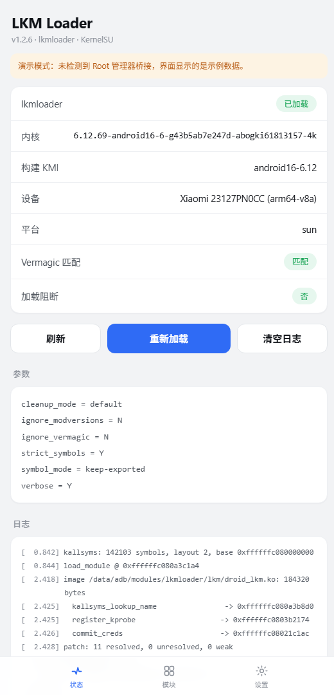
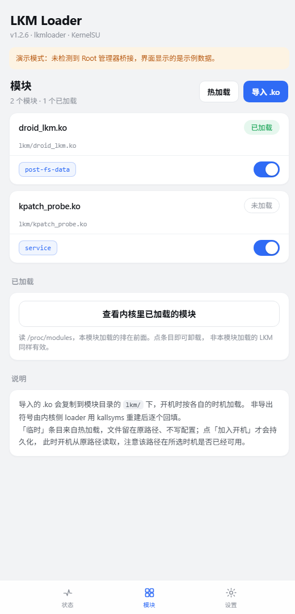
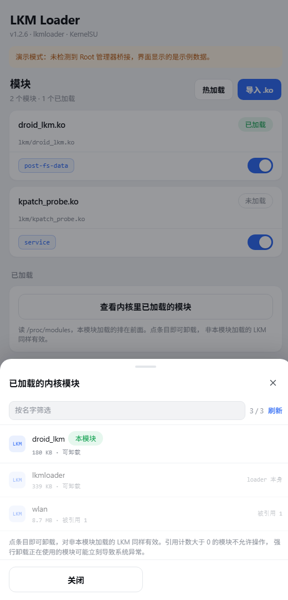
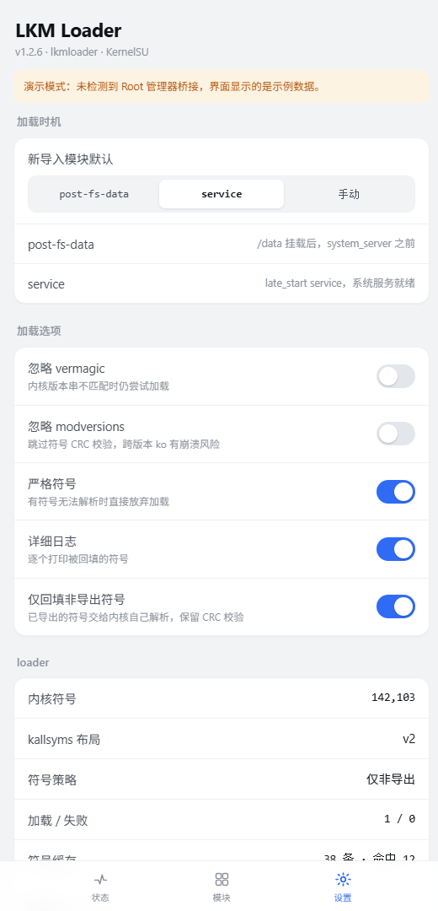
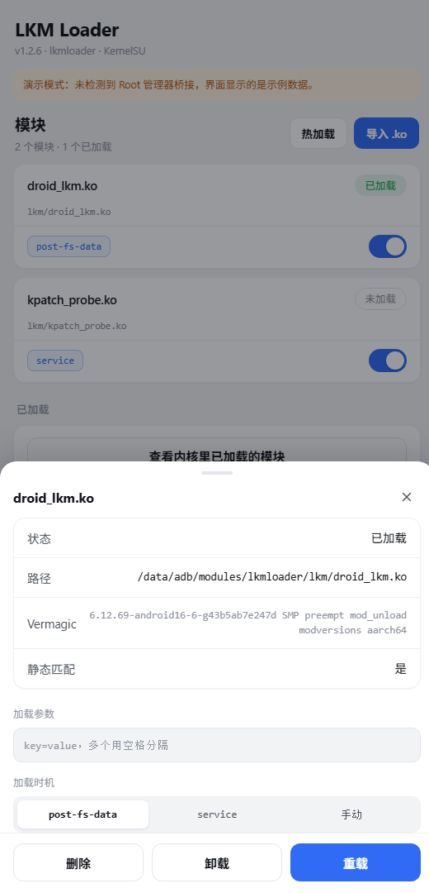

# LKM 加载模块 — 设计与实现

> 工程目录：`lkmloader/`　文档整理时间：2026-10-21
> 一句话：一个带 WebUI 的 LKM 加载模块，用 KallRecon 重建 kallsyms，把目标 `.ko` 的非导出符号回填成绝对地址，再交给内核 `load_module()` 完成真正的加载；支持 KernelSU / APatch / Magisk，支持 `post-fs-data` 与 `service` 两种开机加载时机。

---

## 1. 需求与落地对照

| 需求 | 落地方式 | 主要文件 |
| --- | --- | --- |
| 写一个 LKM 加载模块 | 常驻 loader + `/proc/lkmctl` 控制面 | `loader.c` |
| 支持 KSU / APatch / Magisk | 只用标准模块结构，脚本自检管理器类型 | `common/funcs.sh`、`META-INF/…/update-binary` |
| 用 KallRecon 做符号加载 | `find_kallsyms_base()` + `kallrecon_klp()` + `kallrecon_find_variant()` | `loader.c`、`deps.lst` |
| 用 KMSDK 管依赖 | `.sdk-version` 锁 SDK，`deps.lst` 锁 KallRecon rev | `scripts/fetch-deps.sh` |
| 参考 lkmloader.ko | 复用“patch ELF + 调 `load_module`”的核心思路 | `loader.c` |
| 有 WebUI、JS 分离 | `shell.js` / `lkm.js` / `app.js` 三层 | `webroot/` |
| UI 风格照参考图 | 浅灰底 + 白卡 + 胶囊状态 + 蓝色主按钮 | `webroot/css/style.css` |
| 从设备目录选 ko 导入 | shell 目录遍历 + ELF 校验 + 复制进模块目录 | `app.js`、`lkm.js` |
| 两种加载时机 | 每个 ko 独立 `stage` 字段 | `post-fs-data.sh`、`service.sh` |

---

## 2. 整体架构

```
┌──────────────── WebUI（webroot，跑在管理器内置浏览器里）────────────────┐
│  index.html   app.js（渲染/事件）   lkm.js（配置与动作）  shell.js（exec）│
└───────────────────────────┬────────────────────────────────────────────┘
                            │ ksu.exec / apatch.exec / magisk.exec
                            ▼
┌──────────────────────── 用户态 shell ───────────────────────────────────┐
│  post-fs-data.sh / service.sh → common/funcs.sh                          │
│    · 解析 config.json（行式，无需 jq）                                    │
│    · 过滤 stage + enabled，按 delay 排序执行                              │
│    · insmod ko/lkmloader.ko（一次，常驻）                                 │
│    · printf 'load <path> <args>\n' > /proc/lkmctl                        │
└───────────────────────────┬────────────────────────────────────────────┘
                            │ /proc/lkmctl（命令）、/proc/lkmlog（日志）
                            ▼
┌──────────────────────── 内核态 lkmloader.ko ────────────────────────────┐
│  1. KallRecon：sprint_symbol 为锚点 → 重建 kallsyms → kallsyms_lookup_name│
│  2. 读目标 ko → 解析 .symtab → SHN_UNDEF 全部解析并改写为 SHN_ABS         │
│  3. load_module(&info, uargs, flags) → 内核自己完成重定位与 init          │
│  4. 状态/日志写回 /proc，供 UI 轮询                                       │
└─────────────────────────────────────────────────────────────────────────┘
```

关键取舍：**loader 常驻而不是自卸载**。参考项目用 `task_work` + 裸汇编跳板调用 `delete_module` 实现“载入后自我消失”，代价是强绑定 `sys_call_table` 与 arm64 寄存器布局；常驻方案换来的是：可重复加载多个 ko、可按需重载、有稳定的状态与日志来源。

---

## 3. 内核模块 `loader.c`

### 3.1 初始化顺序

```
lkm_init()
 ├─ kallrecon_set_cleanup_mode(cleanup_mode)   # 仅当 >0
 ├─ find_kallsyms_base()                       # 失败 → -ENODATA
 ├─ lkm_resolve("load_module")                 # 失败 → -ENOSYS
 ├─ proc_create("lkmctl", 0600) / ("lkmlog", 0400)
 └─ ready
```

`klnum_val`（符号总数）、`kl_layout`（v1/v2/v3）、`kernel_base` 都会写进 `/proc/lkmctl`，方便判断“重建到底成没成”。

### 3.2 符号解析的三级回退

```c
addr = kallrecon_klp(name);          /* 内核自带 lookup，最快 */
if (!addr) addr = kallsyms_name_to_addr(name);      /* 自建表查找 */
if (!addr) addr = kallrecon_find_variant(name, 1);  /* CFI/LTO 后缀变体，优先 .cfi_jt */
```

第三级是为了 CFI_CLANG 内核：函数指针调用要求目标是 `.cfi_jt` 跳转表项，否则会被 CFI 检查拦下。

### 3.3 ELF 回填算法

对目标 `.ko`（`ET_REL`）只做一件事：把 `.symtab` 里所有 `SHN_UNDEF` 条目变成“看起来本来就是绝对符号”。

```
1. 校验 ELF64 / ET_REL / e_shentsize
2. 处理扩展节号（e_shnum == 0 时读 sh[0].sh_size）
3. 找到第一个 SHT_SYMTAB，及其 sh_link 指向的 SHT_STRTAB
4. 先读 __versions 段（struct modversion_info: crc + name[56]）
5. 遍历符号（跳过索引 0）：
     st_shndx == SHN_UNDEF 且名字非空
       ├─ 名字在 __versions 里 → 不回填（native），交给内核解析 + CRC 校验
       ├─ 解析成功 → st_value = addr; st_shndx = SHN_ABS
       ├─ 解析失败但 STB_WEAK → 跳过（内核允许 weak 未定义）
       └─ 解析失败 → 计数 + 记录前 12 个符号名
6. strict_symbols=1 且存在未解析符号 → 直接 -ENOENT，不让半残模块进内核
```

为什么这样可行：内核在 `simplify_symbols()` 里只处理 `SHN_UNDEF`，`SHN_ABS` 走“无需处理”分支；后续 `apply_relocations()` 直接用 `st_value` 当绝对地址，于是“非导出符号”被静默绕过。

实测补充：用 ddk 编译本模块时，`__versions` 段是**空的**（长度 0）——因为 modpost 没有内核的
Module.symvers，拿不到符号 CRC。所以 `symbol_mode=0` 只对“带着完整 `__versions` 的目标 ko”
才产生实际差别；对这类裸编的 ko，两种模式等价。这一点不要误解成“默认就一定有 CRC 校验”。

实测补充：用 ddk 编译本模块时，`__versions` 段是**空的**（长度 0）——因为 modpost 没有内核的
Module.symvers，拿不到符号 CRC。所以 `symbol_mode=0` 只对“带着完整 `__versions` 的目标 ko”
才产生实际差别；对这类裸编的 ko，两种模式等价。这一点不要误解成“默认就一定有 CRC 校验”。

**但“绕过”必须限定范围**：`__versions` 里的条目是链接时由 modpost 从 Module.symvers 生成的，说明该符号
当时是导出的，内核本来就能解析并做 CRC 校验。把它们也回填成 `SHN_ABS`，等于白白丢掉一次版本校验。
因此默认 `symbol_mode=0` 只回填“没有版本条目”的符号，日志里分别报 `patched` 与 `native` 两个数字；
真遇到“这个内核不再导出该符号”的情况，再切 `symbol_mode=1` 全量回填。

边界检查统一用 `lkm_range_ok(off, size, len)`（先比 `off > len`，再比 `size > len - off`），
避免 `off + size` 先相加导致溢出；节表数量用除法比较 `shnum > (len - shoff) / entsize`；
另外校验 `sh_entsize == sizeof(Elf64_Sym)`、`sh_size % sizeof(Elf64_Sym) == 0`、
字符串表类型与末尾 NUL、扩展节号 `SHN_XINDEX`。

### 3.4 传给目标模块的参数（最容易踩的坑）

`load_module(info, uargs, flags)` 的 `uargs` 是 `const char __user *`，内核会用 `strndup_user()` 去读——**传内核指针或 NULL 都会失败**。参考项目借 `current_pt_regs()->sp` 往用户栈写，依赖栈布局且有 guard page 风险。

本实现改用 `write()` 的缓冲区本身：

```
write(fd, "load /path/foo.ko debug=1\n", 26)
        └─ 已校验可读的 26 字节，且页内可写
1. put_user('\0', ubuf + 25)      # 把末尾换行改写成 NUL
2. uargs = ubuf + offset(args)    # 指向同一个用户缓冲区里的参数子串
```

这样既不依赖栈布局，也不额外 mmap。代价是**命令必须换行结尾、一次 write 一条命令**——没有换行时，
缓冲区最后一个字节属于调用方数据，`put_user` 无法在不越界的前提下写入 NUL，所以直接返回 `-EINVAL`。
`put_user` 的目标下标恒为 `len <= count - 1`，落在 `copy_from_user` 已验证的范围内。

`write()` 的返回值就是本次操作的 errno：成功返回写入字节数，失败返回负 errno。脚本据此判定，
不再依赖可能过期的全局 `last_errno`。

### 3.5 内存所有权（会 double free 的地方）

`load_module()` 内部 `free_copy()` 会对 `info->hdr` 执行 `vfree()`，**成功与失败路径都会释放**。所以：

- 缓冲区必须用 `vmalloc()` 分配（内核用 `vfree` 释放）
- 调用 `load_module()` 之后，本地指针必须置空，绝不能再 `vfree()`

```c
ret = lkm_load_module_fn(&info, uargs, flags);
lkm_log_add("load_module -> %d", ret);
buf = NULL;              /* 所有权已交给内核 */
...
out_free:
	vfree(buf);          /* 只覆盖“还没交给内核”的失败路径 */
```

### 3.6 `/proc` 协议

| 文件 | 权限 | 方向 | 说明 |
| --- | --- | --- | --- |
| `/proc/lkmctl` | 0600 | 写 | `load <path> [args]`、`clear`；一次 write 一条 |
| `/proc/lkmctl` | 0600 | 读 | 状态，`key=value` 每行一个 |
| `/proc/lkmlog` | 0400 | 读 | 16 KB 环形日志，含逐个符号的回填记录 |

读到的字段：

```
loader / version / kallsyms / num_syms / layout / kernel_base
seq / loads / fails
symbol_mode / strict_symbols / ignore_vermagic / ignore_modversions
last_target / last_patched / last_native / last_miss / last_errno / last_msg
```

`loads` / `fails` 是累计值，**不能**用来判断某一次加载；单次结果看 `write()` 返回值，
细节看 `seq` 与 `last_*`（最后一次操作的目标、回填数、原生解析数、未解析数、errno、消息）。

内核模块参数（改完需 `rmmod` + `insmod` 生效，UI 的“重启 loader”就是干这个）：

| 参数 | 默认 | 说明 |
| --- | --- | --- |
| `verbose` | 1 | 逐个打印回填的符号（每个 ko 最多 8 条，避免刷屏） |
| `strict_symbols` | 1 | 有符号解析失败就放弃 |
| `symbol_mode` | 0 | 0 只回填非导出符号（保留 CRC 校验）/ 1 全部回填 |
| `ignore_vermagic` | 0 | `MODULE_INIT_IGNORE_VERMAGIC` |
| `ignore_modversions` | 0 | `MODULE_INIT_IGNORE_MODVERSIONS`（跨版本有崩溃风险） |
| `cleanup_mode` | -1 | KallRecon 名字清洗：-1 默认 / 0 auto / 1 seqs / 2 llvm / 3 dollar |

---

## 4. 用户态脚本

### 4.1 启动链路

```
post-fs-data.sh ─┐
                 ├─ . common/funcs.sh → lkm_boot <stage>
service.sh ──────┘        ├─ mkdir logs/、lkm/、日志轮转（>128 KB 转 .1）
                          ├─ lkm_log "boot: stage=… kmi=… manager=… uid=…"
                          └─ lkm_load_stage <stage>
                               └─ 逐行读 config.json → 过滤 enabled/stage
                                    └─ lkm_load_one name path args
                                         ├─ 已在 /proc/modules 里（-/_ 归一化）→ skip
                                         ├─ lkm_loader_up（insmod 一次，最多等 4s）
                                         ├─ printf 'load …\n' > /proc/lkmctl
                                         └─ 以 write() 返回值为准判定，last_msg 只补细节
```

整段结束后打一行汇总：`stage=… summary: ok=N fail=N skipped=N`。
`delay` 非法值归零、上限 60 秒，避免 `post-fs-data` 被配置卡住。

### 4.2 为什么配置用“行式 JSON”

设备上不一定有 `jq`，而 WebUI 端天然有 JS。折中：**JSON 合法，但约定一个模块对象占一行**，shell 用 `sed` 就能取字段：

```sh
lkm_entries()   # 只抓 {"name":…} 开头的行
lkm_json_str()  # "key":"value"
lkm_json_num()  # "key":123
lkm_json_bool() # "key":true
```

所以文档里特别标注：**不要手动把模块对象拆成多行**。

### 4.3 安装流程 `customize.sh`

1. `lkm_kmi` 从 `uname -r` 推导 `androidNN-M.m`（先在版本串里找 `androidNN`，找不到再按 5.10/5.15/6.1/6.6/6.12 映射）
2. 从 `ko/<kmi>/lkmloader.ko` 取对应产物；只有**唯一**一个候选命中 `-M.m` 后缀时才兜底，
   多个候选（如 android12-5.10 与 android13-5.10）直接报错退出，不按目录顺序瞎猜
3. 复制到 `ko/lkmloader.ko`，删掉其它 KMI 目录（省空间）
4. 首次安装写入 `ko/options` 与空 `config.json`
5. 修正权限（脚本 755、webroot 文件 644）
6. **自检**：`insmod` 一次（保留 stderr）→ 等 `/proc/lkmctl` → 校验 `loader=lkmloader`、版本与
   `num_syms` → 仅当本次是新加载时才 `rmmod`，卸载失败也会提示。安装日志里能直接看到重建是否成功

---

## 5. WebUI

### 5.1 分层

| 文件 | 职责 | 关键点 |
| --- | --- | --- |
| `shell.js` | 桥接探测、`exec`、文件读写、设备信息 | 统一 `{code,out,err}`，兼容回调与 Promise 两代接口，heredoc 写文本文件 |
| `lkm.js` | 领域层：模块目录、config.json、状态聚合、加载/卸载/重载、日志 | 真实实现与 demo 实现同一套接口 |
| `app.js` | 渲染与交互：三个视图、两个 sheet、轮询、toast | 无框架，纯 DOM，`textContent` 渲染避免注入；所有内核操作走 `guard()` 串行化 |

`guard(fn)` 统一处理三件事：同一时刻只允许一个内核操作、操作期间禁用按钮、异常转成 toast 并解锁。
开关与「默认时机」保存失败时会把 UI 回滚到原值，避免界面与配置文件不一致。

桥接按顺序探测：`ksu` → `apatch` → `kernelsu` → `magisk` → `ksuwebui` → `mmrl`；一个都没有时切到 **demo 模式**（顶部橙色条提示），以便在普通浏览器里调样式——截图即此模式。

### 5.2 导入与热加载

两个入口都走 `<input type="file">`（Android 系统选择器，第三方文件管理器能接管就由它接管），
区别只在落盘位置：

| 入口 | 落盘 | 写 `config.json` |
| --- | --- | --- |
| 导入 .ko | `lkm/<name>.ko` | 是，随模块开机加载 |
| 热加载 | `/data/local/tmp/lkm_hot/<name>.ko` | 否，重启失效 |

`content://` 拿不到真实路径，所以字节先在前端校验，再以 base64 分段（32 KB 一次）追加写入，
设备端 `base64 -d` 落地，最后回读字节数比对：

| 检查 | 依据 |
| --- | --- |
| 大小合理 | 4 KB ~ 64 MB |
| ELF 魔数 | `7f 45 4c 46` |
| ELF64 | `e_ident[EI_CLASS] == 2` |
| 可重定位对象 | `e_type == ET_REL` |
| 落盘完整 | `stat -c %s` 等于原始字节数 |

导入成功后立即尝试加载一次，失败会明确提示而不是只显示“已导入”。
Vermagic / modversions 只作为**静态提示**显示，不作为“能加载”的结论。

### 5.3 视觉规范（对齐参考图）

| 元素 | 值 |
| --- | --- |
| 页面底色 | `#f2f3f5`（深色 `#0e1013`） |
| 卡片 | `#fff`，圆角 14，1px `#eef0f3` 描边 |
| 主文字 / 标签 / 次要 | `#101318` / `#4b5159` / `#8d929b` |
| 主按钮 | `#2f6bf5`，高 46，圆角 12 |
| 成功胶囊 | 文字 `#12a150`，底 `#e6f7ee` |
| 行高 / 内边距 | 46px 最小高，13×16 内边距，行间发丝线 |
| 等宽区域 | 参数 13px / 日志 12px，日志悬挂缩进对齐时间戳 |

页面：状态（照参考图的一列信息卡 + 三按钮 + 参数 + 日志）、模块（卡片列表 + 时机胶囊 + 开关 + 详情 sheet）、
设置（默认时机、五个开关、loader 信息）。设置里的「仅回填非导出符号」对应内核参数 `symbol_mode`。

### 5.4 截图

演示模式（无桥接时页面自己造数据，便于在浏览器里调样式）下的真机版式：

| 状态 | 模块 | 已加载 |
| --- | --- | --- |
|  |  |  |

| 设置 | 模块详情 |
| --- | --- |
|  |  |

---

## 6. 构建与 CI

依赖只有一个：KallRecon，通过 KMSDK 部署。

```
.sdk-version  →  b8a5c645…（KMSDK 提交）
deps.lst      →  KallRecon b258fb67…（KallRecon 提交）
```

```bash
./scripts/fetch-deps.sh                                   # 拉 SDK + deps/KallRecon
./scripts/check.sh                                        # 语法/资源/配置解析
make KDIR=/opt/ddk/kdir/android16-6.12                     # 单版本，VER 自动推导
./build-all.sh                                            # 遍历 /opt/ddk/src
TARGETS="android14-6.1 android16-6.12" ./scripts/package.sh # 也可不带 TARGETS
```

`check.sh` 覆盖：所有 shell 脚本 `sh -n`、`node --check`、HTML 引用完整性、
以及用 fixture 跑一遍行式 JSON 解析（`name/path/stage/enabled/delay/args` 六个字段）。
`package.sh` 会逐个校验 ko（非空、ELF64、`ET_REL`、machine、含 `vermagic`），
打包后再回读 zip 确认必需文件与 `ko/*/lkmloader.ko` 都在。

Makefile 的两个细节：

- `deps/KallRecon/deps.mk` 提供 `DEPS_LIB_OBJS`（含 `lib/anchor.o`，锚点汇编按 arch 自选），用 `addprefix` 挂到模块对象里
- 6.10+ 内核把源文件规则从 `$(src)` 改成 `$(obj)`，因此显式补了 `$(obj)/%.o: $(src)/%.c` 与 `.S` 两条规则（否则 android16-6.12 上找不到源文件）

CI：`.github/workflows/build.yml` 分三段——`check`（依赖部署 + 静态检查）、`build`（7 个 KMI 的矩阵任务并行：5.10 的 12/13、5.15、6.1、6.6、6.12、6.18）、
`package`（汇总产物、校验、打包，tag 时发 Release）。矩阵化的收益是失败只影响单个 KMI，
且总时长等于最慢的单个构建而不是全部之和；`concurrency` 会取消同分支被覆盖的旧运行。

---

## 7. 配置格式

`/data/adb/modules/lkmloader/config.json`：

```json
{
"version":1,
"defaultStage":"service",
"options":{"ignoreVermagic":false,"ignoreModversions":false,"strictSymbols":true,"verbose":true,"keepExported":true},
"modules":[
{"name":"droid_lkm","path":"/data/adb/modules/lkmloader/lkm/droid_lkm.ko","args":"","stage":"post-fs-data","enabled":true,"delay":0}
]
}
```

| 字段 | 含义 |
| --- | --- |
| `defaultStage` | 新导入模块的默认时机 |
| `options.*` | 与 loader 模块参数一一对应（`keepExported` → `symbol_mode=0`），保存后需“重启 loader” |
| `modules[].name` | 模块名（由文件名清洗而来，同时用于 `/proc/modules` 比对，`-`/`_` 两种变体都试） |
| `modules[].args` | 传给目标模块的参数，如 `debug=1` |
| `modules[].stage` | `post-fs-data` / `service` / `manual` |
| `modules[].delay` | `service` 阶段额外等待秒数 |

---

## 8. 已知限制与风险

1. **需要导出 `sprint_symbol`**（GKI 默认导出）。没有它的自编译内核要换锚点。
2. **只支持 arm64**；x86_64 需在 ddk 里加 target（KallRecon 本身支持）。
3. 目标 ko 被 `strip` 掉 `.symtab` 就无法回填，日志会明确报 `no .symtab`。
4. `modversions` 严格匹配同 KMI 产物；`ignore_modversions=1` 能强行过，但符号签名不一致会直接崩。
5. `MODULE_SIG_FORCE=y` 的厂商内核会拒绝未签名模块，无解。
6. 常驻 loader 会多占一点内存（一个模块 + 16 KB 日志缓冲），换来稳定控制面。
7. Magisk 本身没有 WebUI 宿主，需要 KsuWebUI / MMRL 打开 `webroot`。
8. `/proc/lkmctl` 要求命令以换行结尾、一次一条；这是 `uargs` 方案的前提，见 3.4。
9. `symbol_mode=0` 的收益是保留导出符号的 CRC 校验；若某内核不再导出这些符号，需要切到 `symbol_mode=1`。
10. `__versions` 的条目宽度按 `MODULE_NAME_LEN = 56` 计算；若某内核不同，宽度校验会失败并自动退回“全部回填”，不会误判。

---

## 9. 待验证 / 后续

| 项 | 说明 |
| --- | --- |
| 实际编译 | 本机无内核源码与 arm64 工具链，`loader.c` 仅逐行审查；`fetch-deps + build-all` 或 CI 是第一道关 |
| `struct load_info` 字段 | 若某些 KMI 字段名/类型不同（如 `len` 宽度），可能只需调整赋值处 |
| `-I$(srctree)` 头文件路径 | `kernel/module/internal.h` 依赖该 include，个别内核树可能需要额外 `-I` |
| 压缩 ko | 目前不支持 `.ko.xz`（需 `MODULE_INIT_COMPRESSED_FILE`） |
| `__versions` 解析 | 条目宽度按 56 字节算，需在真实 ko 上确认 `patched` / `native` 的分布符合预期 |
| 卸载安全性 | `rmmod` 由 shell 执行；若目标模块有引用计数，卸载会失败并回显 |
| UI 深链 | 已支持 `#status/#modules/#settings`，可再扩到具体模块 |

---

## 10. 审计问题与处理

针对外部审计提出的 20 项，逐条对照代码后的结论如下（v1.1.0 已处理）。

| # | 问题 | 结论 | 处理 |
| --- | --- | --- | --- |
| 1 | 回填 `SHN_ABS` 绕过版本校验 | 成立（此前无区分） | 新增 `symbol_mode`：默认只回填**没有** `__versions` 条目的符号，导出符号交还内核解析 + CRC 校验；日志分报 `patched` / `native`；失败时提示可切 `symbol_mode=1` |
| 2 | ELF 边界检查不严密 | 成立 | 统一 `lkm_range_ok()` 防溢出；`shnum ≤ (len - shoff)/entsize`；校验 `sh_entsize`、`sh_size % sizeof(Elf64_Sym)`、字符串表类型与末尾 NUL、`SHN_XINDEX`；`info.len` 显式限幅 |
| 3 | `uargs` 依赖 `write()` 缓冲区 | 部分成立 | 强制命令以 `\n` 结尾（否则 `-EINVAL`），`put_user` 下标恒在已验证范围内；路径/参数长度上限；参数偏移校验。类型决定不能改成内核指针 |
| 4 | 状态字段含义误导 | 成立 | 新增 `seq`、`last_target`、`last_patched`、`last_native`、`last_miss`；文档与 UI 明确 `loads/fails` 只是累计值 |
| 5 | 私有 `load_module()` 兼容风险 | 成立，但属方案前提 | 未改，文档标注“同 KMI 标签 ≠ ABI 保证”，必须实机验证 |
| 6 | 可能读到上一次的 `last_errno` | 成立 | 以 `write()` 返回值为准（内核返回本次 errno），`last_msg` 只用于补充说明 |
| 7 | 模块名当正则、`-`/`_` 不一致 | 成立 | 改用 `awk '$1 == name'` 精确比较，并同时匹配 `-`→`_` 归一化后的名字 |
| 8 | 行式 JSON 解析对转义不健壮 | 部分成立 | WebUI 侧 `sanitizeArgs()` 拒绝引号/反斜杠/换行/制表符；字段缺失或非法记为失败并写日志；保留行式约定（设备无 jq），并用 fixture 测试兜住 |
| 9 | `delay` 无上限、无汇总 | 成立 | 非法值归零、上限 60 s、每次阶段执行汇总 `ok/fail/skipped` |
| 10 | KMI 兜底多匹配覆盖 | 成立 | 收集候选，唯一才用；多个直接 abort 并列出，不再依赖目录顺序 |
| 11 | KMI 推导不代表 ABI | 成立 | 无法在安装期证明；已消除“任意选一个”的风险，剩余靠自检 + 实机 |
| 12 | 安装自检判据过宽 | 成立 | 保留 `insmod` stderr；校验 `loader=lkmloader`、`version`、`num_syms`；仅本次新加载才 `rmmod`，失败提示 |
| 13 | 卸载无条件返回成功 | 成立（确认缺陷） | 新增 `lkm_unload_one`，返回 `unloaded` / `absent` / `failed:<原因>`；UI 区分三种状态 |
| 14 | Vermagic 判断被当成兼容性 | 成立 | UI 文案改为「Vermagic 匹配 / 静态匹配」，并说明真正结果以加载返回值为准 |
| 15 | 重载统计与语义不准 | 成立 | 只重载 `enabled` 且非 `manual` 的模块，按真实结果统计成功/失败并附最多两条原因 |
| 16 | 缺操作锁、错误被吞 | 成立 | `guard()` 串行化 + 控件禁用 + 错误 toast；开关/默认时机保存失败回滚 UI |
| 17 | 文件列表分隔符与导入校验 | 成立 | 分隔符改 `\037`；导入新增 ELF64/ET_REL/machine/大小/复制后大小比对；重名确认覆盖 |
| 18 | `build-all.sh` 失败检测 | 成立 | 改 `if ! echo make \| ddk shell`，逐个校验产物存在/非空/ELF64/ET_REL |
| 19 | 打包缺少产物校验 | 成立 | 支持 `TARGETS` 显式清单；逐个 `verify_ko`（含 vermagic）；打包后回读 zip 校验必需文件 |
| 20 | CI 只验证“能构建” | 成立 | 新增 `scripts/check.sh`（shell/js 语法、资源引用、配置解析 fixture），CI 先检查再构建，打包用 `TARGETS` 严格模式 |

没有按建议改的部分及理由：

- **改成完整 JSON 解析器**：设备上没有 `jq`，自带解析器不值得；改为“生成侧严格、消费侧校验 + 测试固化”。
- **按操作 ID 建立完整结果记录表**：`seq` + `last_*` 已能覆盖单人操作场景；完整历史属于日志职责。
- **`load_module()` 私有接口**：这是整个方案的前提，只能靠实机验证，不能靠代码消除。

## 11. v1.2.0 优化

审计项处理完之后，按实机收益从大到小做了五项，对外协议（`/proc` 命令、配置格式、WebUI 行为）不变。

### 11.1 符号解析缓存

`lkm_resolve()` 原来对每个未定义符号都跑一次三级查找，而 kallsyms 查询本质是十万级名字的线性扫描，
几百个符号的 ko 就是上千万次字符串比较。现在用一个 509 槽的开放寻址表缓存 `name → addr`：

- **只缓存命中**：查不到的名字每次都重试，因为提供者可能是稍后才加载的另一个模块；
- 表满时静默跳过，不影响正确性；名字超过 47 字节不缓存，避免截断后误命中；
- `flush` 命令清空缓存，脚本在 `rmmod` 成功后自动发一次，防止拿到已卸载模块的地址。

`/proc/lkmctl` 新增 `cache_used` / `cache_hits` / `cache_misses`，设置页也会显示，便于判断命中率。
实测口径：同一 ko 重载、或多个 ko 共享符号时才明显受益；单次冷加载的收益来自省掉重复查找。

### 11.2 `__versions` 查表改成哈希

`lkm_versions_has()` 原来对每个符号线性扫一遍版本表。现在加载镜像时按 FNV-1a 建索引
（2 的幂大小，`kvcalloc`），命中 O(1)；分配失败自动退回线性扫描，行为不变。
索引在 patch 结束时 `kvfree`，不占常驻内存。

### 11.3 `/proc/lkmctl` 读路径去掉 kmalloc

状态行是固定的，改成 1.8 KB 静态缓冲区，在 `lkm_lock` 内填充后直接 `simple_read_from_buffer()`。
原先每次 `cat` 都要一次 `kmalloc(1536)`，而 WebUI 会周期性读取这个文件。

### 11.4 WebUI 轮询先比 `seq`

每个 tick 只读一次 `/proc/lkmctl`；`seq` 没变就只更新计数，不重新拉日志、不重建 DOM。
原来每 8 秒把日志区整体重建一次，是 WebView 里最明显的周期性开销。

### 11.5 CI 矩阵化

见 §6 最后一段。

---

## 12. WebUI 设计（现状）

### 12.1 桥接：两种 exec 形态都要吃

管理器的 WebUI 接口有两代。KernelSU 原生是**回调式**：`exec(cmd, opts, callbackName)`，
第三个参数是全局回调函数名，函数本身返回 `undefined`；KsuWebUI / MMRL 则返回 Promise。
只认 Promise 会把 `undefined` 当成结果，解析出 `{code:0,out:''}`——所有 `cat /proc/lkmctl`、
`getprop` 都成了空串，界面就会报「未加载 / 未知设备」，而 loader 其实在跑。

所以：调用时永远带第三个参数；返回值是 thenable 就走 Promise 路径，否则等回调。
回调兼容 `(errno, stdout, stderr)`、单个结果对象、JSON 字符串三种形态。
桥接既不回话也不返回 Promise 时抛 `TIMEOUT`，界面明确写「无法读取」，而不是把「读不到」
伪装成「没加载」。

### 12.2 加载判定：两个来源

`/proc/lkmctl` 是权威来源，但它可能因权限或 SELinux 读不到。现在
`loaderUp = /proc/lkmctl 里有 loader=lkmloader` **或** `/proc/modules` 里有 `lkmloader`。
只有后者成立时状态卡注明「已加载，但 ctl 读不到」，符号/缓存数字沿用上一次的值而不是归零。

### 12.3 少开 shell、少重建 DOM

- 状态页一次 exec 拿全：设备属性 + `/proc/lkmctl` + `ko` 是否存在 + `/proc/modules` 命中结果。
- `resolveModDir()` / `loadConfig()` 缓存的是 Promise，并发调用只跑一次。
- 轮询（6 s）只读一次计数器；`seq` 没变就不拉日志、不重建 DOM。
- vermagic 每个文件只解析一次并缓存；读取用 `tr '\0' '\n' | grep -m1 '^vermagic='`，
  比 `strings` 全文扫描快，也不会被 `ignore_vermagic=%d` 那个参数串误导。
- 日志区先比内容再重建；用户往上翻看时不强制滚到底；切 tab 不再触发请求。

### 12.4 导入：系统文件选择器 + base64 分段落盘

`<input type="file">` 在 WebView 里会拉起 Android 的选择器，第三方文件管理器也能接管，
页面里不再需要一棵目录树。`content://` 没有路径，于是字节走前端校验 → base64 每 32 KB 追加 →
设备端 `base64 -d` 落地 → 回读字节数比对。检查项见 §5.2。

隐藏 input 用 `position: fixed; left: -9999px`，不用 `display: none`：部分 WebView 会拒绝
在不可见元素上触发选择器。

### 12.5 热加载与「已加载」

- 热加载复用同一套字节流，只落到 `/data/local/tmp/lkm_hot/<name>.ko`，交给 `lkm_load_one`，
  配置一个字不写；会话内记一条临时条目，可卸载，也可「加入开机」转正。
- 「已加载」读 `/proc/modules`（一次 awk），本模块管理的名字排最前并标「本模块」，
  `refcount > 0` 与 loader 自身禁用卸载；卸载走 `lkm_unload_one`，对非本模块加载的 LKM 同样有效。
- 列表只看内核当前状态。文件躺在 `/data/adb/modules` 或 Download 里不代表它被加载过，
  所以不做文件系统扫描。

### 12.6 sheet 的高度预算

`.sheet` 是 flex 列 + `max-height: 88vh`，内容超预算时如果让所有子元素一起缩，头部行和底部按钮
会互相压住。现在 chrome（head / filter-row / note / foot）一律 `flex: 0 0 auto`，
只有 `.filelist` 可伸缩且 `min-height: 0`，sheet 自身 `overflow: hidden`；
矮屏用媒体查询收紧间距并隐藏说明，极矮屏只保证底部按钮可见。

### 12.7 关于 “unresolved symbol” 这类失败

strict 模式下 loader 遇到补不上的符号会直接 abort。这类符号既不在 kallsyms，也不是任何已加载模块
导出的，所以**任何** loader 都补不了——绝大多数情况是目标 ko 少链了依赖库的对象文件
（HooKern 这种按组拆分的库最容易踩）。

实际案例：MountHide 的 `mhsrc.ko` 只链了 core / patch / ptr / kprobe / kretprobe 七个对象，
却没给 `-DHK_NO_INLINE -DHK_NO_REDIR -DHK_NO_SIGHOOK`。而 `hk.c` 的 `hk_exit()` 与
`hk_exit_block()` 无条件调用各组，于是 `hk_inline_exit`、`hk_inline_pending`、`hk_redir_pending`、
`hk_redir_inflight`、`hk_sighook_exit` 五个引用悬空，`modpost` 若只当警告放过，产物就是坏的。

结论：不要为了让它加载而关掉 `strict_symbols`，那只是把 0 当函数指针，退出路径必崩。
正确做法是在构建端补对象文件，或补齐 `HK_NO_*` 让核心不再调用这些组。

---

## 13. 参考

- [KallRecon](https://github.com/Dere3046/KallRecon) — kallsyms 重建（`doc/API.md` 是主要依据）
- [KMSDK](https://github.com/Dere3046/KMSDK) — `deps.lst` / `.sdk-version` / `scripts/sdk` 约定
- [Kernel-SU/lkmloader.ko](https://github.com/Kernel-SU/lkmloader.ko) — ELF patch + `load_module` 思路
- [ddk](https://github.com/Ylarod/ddk) — 多 KMI 构建与 `src/obj` 规则修正
- 项目根 `README.md` — 面向使用者的快速上手
